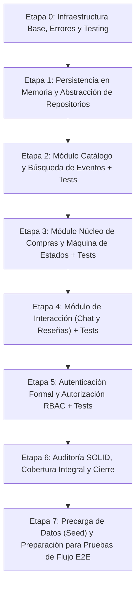

# Plan de Implementación Técnico - AI Ticket It (Backend)

Este documento detalla el plan de implementación por etapas para el backend de la plataforma **AI Ticket It**, desarrollado en **Node.js + Express**. La arquitectura contempla una separación en capas (**Controllers**, **Services**, **Repositories**) orientada a una **API REST**, guiada por los principios **SOLID**, persistencia en memoria y una estrategia de **Testing continuo a la par del desarrollo de features**.

---

## 1. Decisiones Arquitectónicas y Principios de Diseño

1. **Desarrollo Vertical por Módulos:**
   - La construcción se organiza en slices verticales que respetan el grafo de dependencias de las entidades.
   - Cada slice abarca desde el repositorio hasta el controlador y sus pruebas asociadas.

2. **Inversión de Dependencias (DIP) y Desacoplamiento:**
   - Los servicios reciben sus dependencias (repositorios u otros servicios) mediante inyección en el constructor.
   - Las instancias singleton por defecto permiten un uso directo en producción, mientras que la inyección por constructor habilita el testeo unitario con mocks y stubs.

3. **Responsabilidad Única (SRP) y Modelo Enriquecido:**
   - **Modelos de Dominio:** Encapsulan sus propios datos e invariantes (ej. `hayCupoPara`, validación de transiciones de estado, `tuPrecioEstaEntre`).
   - **Servicios:** Orquestan casos de uso, coordinan repositorios, lanzan errores de dominio específicos y computan atributos derivados (ej. cálculo de días faltantes hasta el evento).
   - **Controladores:** Manejan exclusivamente la capa de transporte HTTP (extracción de parámetros/body, delegación al servicio y respuesta con código HTTP).

4. **Validación y Manejo Centralizado de Errores:**
   - Los contratos HTTP de entrada se validan mediante middlewares con **Zod** antes de ingresar al controlador.
   - La lógica de negocio arroja excepciones semánticas basadas en `AppError` (`ValidationError` 400, `NotFoundError` 404, `ConflictError` 409, `UnauthorizedError` 401, `ForbiddenError` 403).
   - Un middleware centralizado de errores (`errorHandler`) captura las excepciones y formatea la respuesta JSON final.

5. **Estrategia de Autenticación Diferida:**
   - En las primeras etapas de negocio, la identidad y el rol (`comprador` / `organizador`) se consumen a través de un contexto desacoplado (middleware simulado / headers `x-user-id` y `x-user-role`).
   - La implementación formal de autenticación (tokens, hashing, expiración) se aborda en una etapa posterior sin alterar la lógica de negocio ni la persistencia.

6. **Testing a la par de cada Feature:**
   - Cada funcionalidad se acompaña inmediatamente de:
     - **Tests unitarios (Jest):** Verifican reglas de negocio en servicios y modelos, aislando la persistencia mediante mocks.
     - **Tests de integración (Jest + Supertest):** Verifican rutas, middlewares, códigos de estado HTTP y contratos JSON.

---

## 2. Desglose de Etapas del Plan

---

### Etapa 0: Infraestructura Base, Errores y Testing

**Objetivo:** Establecer el andamiaje técnico común sobre el cual se montarán todos los módulos de negocio.

- **Componentes a implementar:**
  - Completar la jerarquía de errores en `backend/errors/appError.js` agregando `UnauthorizedError` (401) y `ForbiddenError` (403).
  - Consolidar el middleware de errores centralizado en `backend/middlewares/errorHandler.js`.
  - Crear middleware genérico de validación con Zod (`validate.js`) aplicable a `body`, `query` y `params`.
  - Crear un middleware provisional de contexto de usuario (`mockAuth.js`) que lea `x-user-id` y `x-user-role` para desacoplar el desarrollo de negocio de la autenticación real.
  - Configurar Jest (`jest.config.js`) y dependencias para soporte de módulos ES (`type: "module"` o flags de node).
- **Testing a la par:**
  - Pruebas unitarias para `errorHandler` y `validate` comprobando el formateo de errores 400 y 500.

---

### Etapa 1: Persistencia en Memoria y Abstracción de Repositorios

**Objetivo:** Proveer la capa de persistencia requerida utilizando almacenamiento en memoria desacoplado, respetando el modelo de dominio ya implementado.

- **Componentes a implementar:**
  - Repositorio base o utilitarios para operaciones CRUD en memoria (asignación de IDs autoincrementales o UUID, indexación por ID).
  - Repositorios específicos:
    - `UsuarioRepository`: búsqueda por ID, consulta de lista de usuarios.
    - `CategoriaRepository`: listado y búsqueda por ID.
    - `EventoRepository`: guardado, búsqueda por ID, filtrado dinámico (texto, categoría, precio, organizador).
    - `CompraRepository`: guardado, búsqueda por ID, filtros por `compradorId` y `eventoId`.
    - `CambioEstadoCompraRepository`: registro y consulta cronológica de transiciones.
    - `MensajeRepository` y `ReseniaRepository`: persistencia de chats y valoraciones.
- **Testing a la par:**
  - Tests unitarios para cada repositorio verificando inserción, consulta, actualización y consistencia de datos en memoria.

---

### Etapa 2: Módulo de Catálogo y Búsqueda de Eventos 

**Objetivo:** Permitir a los organizadores publicar eventos con distintos tipos de entrada y a los compradores consultar, buscar y ordenar el catálogo.

- **Componentes a implementar:**
  - **Dominio utilizado:** `Evento`, `TipoEntrada`, `Categoria` (ya implementados).
  - **Capa Servicio (`EventoService`):**
    - `crearEvento({ organizadorId, nombre, descripcion, categoriaId, fecha, tiposEntrada, multimedia })`: valida existencia de categoría y que los tipos de entrada tengan cupo y precio positivos.
    - `buscarEventos({ texto, categoriaId, precioMin, precioMax, orden })`: orquesta filtros textuales, de categoría y rango de precios utilizando el método de dominio `tuPrecioEstaEntre(min, max)`. Implementa ordenamiento por fecha del evento, precio y reputación del organizador.
    - `obtenerEventoPorId(id)`: consulta detalle completo con cupos disponibles.
  - **Capa Transporte (`EventoController` + Rutas):**
    - Schemas de validación Zod para creación de evento y parámetros de búsqueda.
    - Endpoints:
      - `GET /api/eventos` (búsqueda y filtros) $\rightarrow$ 200.
      - `GET /api/eventos/:id` $\rightarrow$ 200 / 404.
      - `POST /api/eventos` (requiere contexto de organizador) $\rightarrow$ 201 / 400 / 403.
- **Testing a la par:**
  - **Unitarios:** `EventoService` con mock de `EventoRepository` para verificar ordenamientos, filtrado de precios y validaciones.
  - **Integración:** Peticiones HTTP completas con Supertest a `/api/eventos` probando éxito y errores 400 y 404.

---

### Etapa 3: Módulo Crítico de Compras y Máquina de Estados 

**Objetivo:** Implementar el flujo transaccional de adquisición de entradas, control estricto de cupos, cálculo de días restantes y ciclo de vida de la compra con auditoría.

- **Componentes a implementar:**
  - **Dominio utilizado:** `Compra`, `CambioEstadoCompra`, `estadoCompra` (ya implementados).
  - **Capa Servicio (`CompraService`):**
    - `crearCompra({ compradorId, eventoId, tipoEntradaId, cantidad })`:
      - Valida existencia del evento y tipo de entrada.
      - Invoca `tipoEntrada.hayCupoPara(cantidad)`. Si no hay cupo, lanza `ConflictError` (409).
      - Decrementa el cupo del `TipoEntrada`.
      - Instancia `Compra` en estado `CONFIRMADA` con cálculo de total (`cantidad * precio`).
      - Registra `CambioEstadoCompra` (estado inicial `CONFIRMADA`, usuario responsable, timestamp).
    - `obtenerCompras({ compradorId, eventoId, usuarioActual })`:
      - Filtra compras según rol/usuario solicitante.
      - Para compras en estado `CONFIRMADA`, calcula dinámicamente el campo derivado `diasFaltantes` con respecto a la fecha actual y la fecha del evento.
    - `cancelarCompra(id, { usuarioActual })`:
      - Valida que la compra exista y pertenezca al usuario (o rol correspondiente).
      - Regla de negocio: la compra no debe estar en estado `UTILIZADA` y la fecha del evento debe ser futura. Si se incumple, lanza `ConflictError` (409).
      - Restituye el cupo en el `TipoEntrada`.
      - Realiza la transición a `CANCELADA` y registra `CambioEstadoCompra`.
    - `utilizarCompra(id, { usuarioActual })`:
      - Valida que el evento no haya expirado y que el estado previo sea `CONFIRMADA`.
      - Realiza la transición a `UTILIZADA` y registra `CambioEstadoCompra`.
  - **Capa Transporte (`CompraController` + Rutas):**
    - Schemas de validación Zod para payloads y parámetros.
    - Endpoints:
      - `POST /api/compras` $\rightarrow$ 201 / 400 / 404 / 409.
      - `GET /api/compras` $\rightarrow$ 200.
      - `GET /api/compras/:id` $\rightarrow$ 200 / 404.
      - `GET /api/compras/:id/historial` $\rightarrow$ 200.
      - `PATCH /api/compras/:id/estado` con `{ estado: "CANCELADA", motivo? }` (comprador) $\rightarrow$ 200 / 400 / 401 / 403 / 404 / 409.
      - `PATCH /api/compras/:id/estado` con `{ estado: "UTILIZADA" }` (organizador) $\rightarrow$ 200 / 400 / 401 / 403 / 404 / 409.
- **Testing a la par:**
  - **Unitarios:**
    - Pruebas exhaustivas de decremento y restitución de cupo.
    - Validación del cálculo exacto de `diasFaltantes`.
    - Transiciones inválidas arrojando `ConflictError` (cancelar compra utilizada o evento pasado).
    - Verificación del registro histórico en `CambioEstadoCompra`.
  - **Integración:**
    - Happy path completo de compra y cancelación vía HTTP con Supertest.
    - Casos de conflicto concurrentes y respuestas 409.

---

### Etapa 4: Módulo de Interacción Post-Compra (Chat y Reseñas) 

**Objetivo:** Habilitar el canal de comunicación bidireccional sobre compras y el sistema de reputación por calificaciones.

- **Componentes a implementar:**
  - **Dominio utilizado:** `Mensaje`, `Resenia` (ya implementados).
  - **Capa Servicio (`MensajeService` y `ReseniaService`):**
    - `enviarMensaje(compraId, { usuarioId, texto })`:
      - Valida que la compra exista.
      - Valida que el emisor sea el comprador de la orden o el organizador del evento. Si no lo es, lanza `ForbiddenError` (403).
      - Guarda el mensaje en el historial de la compra.
    - `crearResenia({ compradorId, eventoId, puntuacion, detalle })`:
      - Valida que el comprador haya tenido una compra en estado `UTILIZADA` para ese evento. Si no la tiene, lanza `ConflictError` (409).
      - Valida rango de puntuación (numérico, ej. 1 a 5).
      - Guarda la reseña asociada al evento y organizador.
    - `obtenerReseniasPorOrganizador(organizadorId)`:
      - Calcula la reputación promedio del organizador para retroalimentar el catálogo de eventos.
  - **Capa Transporte:**
    - Endpoints para chat: `GET /api/compras/:id/mensajes`, `POST /api/compras/:id/mensajes`.
    - Endpoints para reseñas: `POST /api/resenias`, `GET /api/organizadores/:id/resenias`.
- **Testing a la par:**
  - **Unitarios:** Verificación de permisos de chat y restricción de reseñas sin entrada utilizada previa.
  - **Integración:** Pruebas HTTP de envío de mensaje y creación de reseña comprobando códigos 201, 403 y 409.

---

### Etapa 5: Módulo de Autenticación y Autorización Formal (RBAC)

**Objetivo:** Sustituir el contexto simulado (`mockAuth`) por un sistema formal de autenticación y control de acceso basado en roles, aprovechando la separación de capas sin tocar la lógica de negocio.

- **Componentes a implementar:**
  - **Capa Servicio (`AuthService`):**
    - Métodos para registro y login de usuarios con generación de tokens (JWT o token de sesión en memoria).
  - **Middlewares Definitivos:**
    - `authMiddleware`: extrae el token del header `Authorization: Bearer <token>`, valida firma y expiración, e inyecta el usuario autenticado en `req.user`. Si no es válido, lanza `UnauthorizedError` (401).
    - `authorizeRoles(...rolesPermitidos)`: valida que `req.user.rol` pertenezca a los roles admitidos. Si no coincide, lanza `ForbiddenError` (403).
  - **Sustitución Transparente:**
    - Reemplazar en los routers la referencia de `mockAuth` por `authMiddleware` y `authorizeRoles`.
- **Testing a la par:**
  - Tests unitarios de generación y validación de tokens.
  - Tests de integración sobre endpoints protegidos validando rechazo por falta de token (401) y por rol insuficiente (403).

---

### Etapa 6: Cobertura Integral, Casos Borde y Cierre

**Objetivo:** Ejecutar la suite completa de pruebas, validar la adherencia a los criterios de aceptación y auditar los principios SOLID.

- **Tareas de la etapa:**
  - Medición de cobertura global con Jest: asegurar umbrales altos de cobertura en services y models.
  - Verificación de casos borde: eventos con cupo cero, eventos en la fecha límite, compradores cancelando múltiples veces.
  - Checklist de calidad de arquitectura:
    - [x] ¿Los controladores delegan todas las operaciones a los servicios sin contener lógica de negocio?
    - [x] ¿Los servicios reciben sus dependencias por inyección en el constructor (DIP)?
    - [x] ¿Los repositorios en memoria encapsulan completamente su almacenamiento interno?
    - [x] ¿Los modelos de dominio defienden sus invariantes (`hayCupoPara`, transiciones de estado)?
    - [x] ¿Todos los errores son instancias tipadas de `AppError` capturadas por el middleware central?

---

### Etapa 7: Precarga de Datos (Seed) y Preparación para Pruebas de Flujo E2E

**Objetivo:** Proveer un conjunto representativo, coherente e interconectado de entidades del dominio en memoria para facilitar las pruebas manuales de flujo (Postman, cURL) y la futura integración con el cliente frontend móvil.

- **Componentes a implementar:**
  - Módulo sembrador (`backend/utils/seed.js`):
    - Instanciación de modelos ricos de dominio: `Usuario`, `Categoria`, `TipoEntrada`, `Evento`, `Compra`, `CambioEstadoCompra`, `Mensaje`, `Resenia`.
    - Precarga de usuarios con roles y credenciales coincidentes con las colecciones de Postman (`usr-organizador-1`, `usr-organizador-2`, `usr-comprador-1`, `usr-comprador-2`).
    - Precarga de 4 categorías temáticas (Música, Teatro, Deportes, Conferencias).
    - Precarga de 4 eventos con fechas relativas (futuros y pasados) y variedad de tipos de entrada, precios y cupos (incluyendo eventos de cupo limitado para testear agotamiento).
    - Precarga de compras en distintos estados (`CONFIRMADA` con cálculo dinámico de `diasFaltantes`, `UTILIZADA` para habilitar calificación).
    - Precarga de chat bidireccional sobre compra activa y reseñas con cálculo automático de reputación del organizador.
    - Precarga de eventos favoritos para el comprador.
  - Integración en el ciclo de vida del servidor:
    - Ejecución automática de `seedDatabase()` en `backend/server.js` al levantar la aplicación.
    - Rutas de desarrollo `POST /api/seed` y `GET /api/seed` en `backend/routes/seedRoutes.js` para reinicialización y verificación en caliente.
    - Script standalone `"seed": "node backend/utils/seed.js"` en `package.json`.
- **Testing a la par:**
  - Suite `tests/seed.test.js`:
    - Verificación del resumen de entidades sembradas.
    - Validación de métodos de dominio sobre datos precargados (`tuPrecioEstaEntre`, `yaOcurrio`, `tieneFavorito`).
    - Validación de los endpoints HTTP `/api/seed`.

---

## 3. Matriz de Códigos HTTP por Escenario

| Código HTTP | Significado | Escenario de Aplicación |
|---|---|---|
| `200 OK` | Operación exitosa | Consultas (`GET`), actualizaciones de estado (`PATCH cancelar / utilizar`). |
| `201 Created` | Recurso creado | Creación de evento, compra, mensaje o reseña. |
| `400 Bad Request` | Error de validación | Payload inválido según el schema de Zod (tipos incorrectos, campos requeridos faltantes, cantidades negativas). |
| `401 Unauthorized` | No autenticado | Token ausente, firma inválida o sesión expirada. |
| `403 Forbidden` | No autorizado | Usuario autenticado intentando acceder o modificar un recurso ajeno o con rol no permitido. |
| `404 Not Found` | No encontrado | Evento, compra, tipo de entrada o usuario inexistente en el repositorio. |
| `409 Conflict` | Conflicto de negocio | Sin cupo disponible para la cantidad solicitada; intento de cancelación de compra utilizada o evento ya realizado; intento de reseña sin compra utilizada. |
| `500 Internal Error` | Error inesperado | Excepciones no controladas manejadas por el `errorHandler`. |
